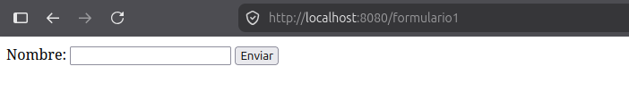
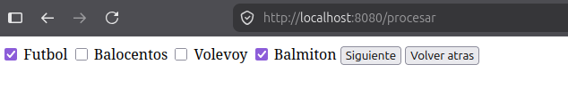
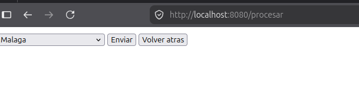
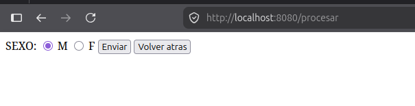
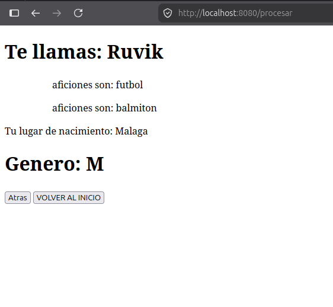
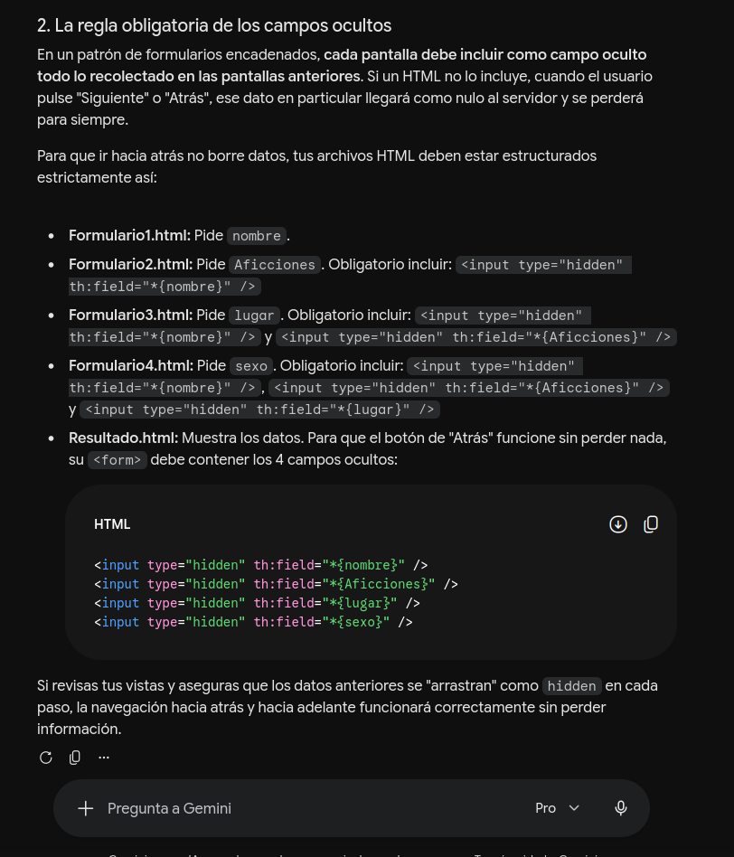

<div class="cover">
<p class="serial">CUADERNO DE PRÁCTICAS // DESARROLLO WEB</p>

# D3 · UD2<br>SPRING BOOT

<p class="subtitle"><strong>Formularios encadenados</strong></p>
<p>Kerin Aguilera</p>
<p class="serial">JAVA 21 · SPRING BOOT · NOVIEMBRE 2026</p>
</div>

<div class="toc">
<p class="toc-title">ÍNDICE DE RUTA</p>
<ol>
<li><a href="#objetivo">Objetivo de la práctica</a></li>
<li><a href="#ejecucion">Cómo ejecutar el proyecto</a></li>
<li><a href="#recorrido">Recorrido del formulario</a></li>
<li><a href="#paso-1">Paso 1 · Nombre</a></li>
<li><a href="#paso-2">Paso 2 · Aficiones</a></li>
<li><a href="#paso-3">Paso 3 · Lugar</a></li>
<li><a href="#paso-4">Paso 4 · Sexo</a></li>
<li><a href="#resultado">Resultado y navegación</a></li>
<li><a href="#controlador">Controlador y modelo de datos</a></li>
<li><a href="#conservacion">Conservación de datos entre peticiones</a></li>
<li><a href="#pruebas">Pruebas automáticas</a></li>
<li><a href="#resumen">Resumen de conceptos</a></li>
</ol>
</div>

# Formularios encadenados con Spring Boot

<a id="objetivo"></a>

## Objetivo

En esta práctica se construye un formulario dividido en varios pasos. En cada paso se solicitan datos distintos y, al final, se muestra un resumen con toda la información introducida.

El ejemplo utiliza Spring Boot, Thymeleaf y un objeto Java (`TusDatos`) para enlazar los campos del formulario con el modelo. Como las peticiones HTTP no conservan automáticamente el estado entre una página y otra, los datos ya introducidos deben volver a enviarse en los formularios siguientes mediante campos ocultos.

<a id="ejecucion"></a>

## Cómo ejecutar el proyecto

El proyecto se encuentra en `PROYECTOS/D3-UD2` y utiliza el wrapper de Gradle incluido en el repositorio.

```bash
cd PROYECTOS/D3-UD2
./gradlew bootRun
```

En Windows:

```powershell
cd PROYECTOS\D3-UD2
.\gradlew.bat bootRun
```

Después se abre el navegador en:

```text
http://localhost:8080/
```

La ruta raíz redirige automáticamente a `http://localhost:8080/formulario1`.

Para ejecutar las pruebas:

```bash
./gradlew test
```

En Windows:

```powershell
.\gradlew.bat test
```

<a id="recorrido"></a>

### Recorrido de la práctica

1. Se solicita el nombre.
2. Se seleccionan las aficiones.
3. Se elige un lugar.
4. Se indica el sexo.
5. Se muestra un resumen con los datos y las opciones para volver atrás o empezar de nuevo.

Cada formulario conserva los datos de los pasos anteriores en campos ocultos. El parámetro `contador` indica al controlador qué vista debe mostrarse a continuación.

<a id="paso-1"></a>

## Paso 1 · Introducir el nombre

El primer formulario no necesita campos ocultos: todavía no hay datos anteriores que conservar. El atributo `th:object` vincula los campos al objeto que recibe la plantilla.

```html
<!DOCTYPE html>
<html lang="es" xmlns:th="http://www.thymeleaf.org">
<head>
    <meta charset="UTF-8">
    <title>Formulario 1 · Nombre</title>
</head>
<body>
<h1>Paso 1 · Tu nombre</h1>

<form method="post" th:action="@{/procesar}" th:object="${datos}">
    <p>
        <label for="nombre">Nombre:</label>
        <input id="nombre" type="text" th:field="*{nombre}" autocomplete="name" required>
    </p>

    <button type="submit" name="contador" value="1">Enviar</button>
</form>
</body>
</html>
```

El botón envía `contador=1`. El controlador responde con la vista `Formulario2`.

Para comprobar los datos recibidos durante el desarrollo se pueden imprimir temporalmente en la consola desde el controlador:

```java
System.out.println(datos);
System.out.println(contador);
```

Por ejemplo, después de enviar el nombre y marcar dos aficiones, la consola mostraría:

```text
TusDatos(nombre=Ruvik, aficciones=[Baloncesto, Bádminton], lugar=null, sexo=null)
2
```

La versión final del controlador no imprime en consola; esas líneas se utilizaron únicamente para depurar.

Así se ve el primer formulario:



<a id="paso-2"></a>

## Paso 2 · Seleccionar las aficiones

El segundo formulario recibe el nombre del paso anterior. El campo oculto `nombre` permite volver a enviarlo junto con las nuevas selecciones.

```html
<!DOCTYPE html>
<html lang="es" xmlns:th="http://www.thymeleaf.org">
<head>
    <meta charset="UTF-8">
    <title>Formulario 2 · Aficiones</title>
</head>
<body>
<h1>Paso 2 · Tus aficiones</h1>

<form method="post" th:action="@{/procesar}" th:object="${datos}">
    <fieldset>
        <legend>Selecciona tus aficiones:</legend>

        <label><input type="checkbox" th:field="*{aficciones}" value="Fútbol"> Fútbol</label>
        <label><input type="checkbox" th:field="*{aficciones}" value="Baloncesto"> Baloncesto</label>
        <label><input type="checkbox" th:field="*{aficciones}" value="Voleibol"> Voleibol</label>
        <label><input type="checkbox" th:field="*{aficciones}" value="Bádminton"> Bádminton</label>
    </fieldset>

    <button type="submit" name="contador" th:value="${contador + 1}">Siguiente</button>
    <button type="submit" name="contador" value="-1">Volver atrás</button>

    <input type="hidden" th:field="*{nombre}">
</form>
</body>
</html>
```

El botón **Siguiente** envía `contador + 1`, es decir, `2`. El botón **Volver atrás** envía `-1`, un valor reservado para regresar al paso 1 sin perder el nombre. No se utiliza `0` para volver atrás porque `0` significa «empezar de nuevo».

Vista del formulario:



<a id="paso-3"></a>

## Paso 3 · Elegir un lugar

El tercer formulario añade el lugar y vuelve a enviar los datos de los pasos anteriores. Para conservar una colección, como `aficciones`, se genera un campo oculto por cada elemento de la lista.

```html
<!DOCTYPE html>
<html lang="es" xmlns:th="http://www.thymeleaf.org">
<head>
    <meta charset="UTF-8">
    <title>Formulario 3 · Lugar</title>
</head>
<body>
<h1>Paso 3 · Lugar de nacimiento</h1>

<form method="post" th:action="@{/procesar}" th:object="${datos}">
    <p>
        <label for="lugar">Lugar:</label>
        <select id="lugar" th:field="*{lugar}" required>
            <option value="">-- Selecciona una opción --</option>
            <option value="Madrid">Madrid</option>
            <option value="Sevilla">Sevilla</option>
            <option value="Málaga">Málaga</option>
        </select>
    </p>

    <button type="submit" name="contador" th:value="${contador + 1}">Siguiente</button>
    <button type="submit" name="contador" th:value="${contador - 1}">Volver atrás</button>

    <input type="hidden" th:field="*{nombre}">
    <input type="hidden" th:each="aficcion : ${datos.aficciones}"
           name="aficciones" th:value="${aficcion}">
</form>
</body>
</html>
```

El botón **Siguiente** envía `3`; el botón **Volver atrás** envía `1`, que devuelve al paso 2 conservando las aficiones.

Vista del formulario:



<a id="paso-4"></a>

## Paso 4 · Añadir el sexo

El cuarto formulario incorpora una selección con botones de opción. También debe reenviar los valores anteriores para que sigan disponibles al procesar el formulario.

```html
<!DOCTYPE html>
<html lang="es" xmlns:th="http://www.thymeleaf.org">
<head>
    <meta charset="UTF-8">
    <title>Formulario 4 · Sexo</title>
</head>
<body>
<h1>Paso 4 · Sexo</h1>

<form method="post" th:action="@{/procesar}" th:object="${datos}">
    <fieldset>
        <legend>Selecciona una opción:</legend>

        <label><input type="radio" th:field="*{sexo}" value="M" required> Masculino (M)</label>
        <label><input type="radio" th:field="*{sexo}" value="F"> Femenino (F)</label>
    </fieldset>

    <button type="submit" name="contador" th:value="${contador + 1}">Finalizar</button>
    <button type="submit" name="contador" th:value="${contador - 1}">Volver atrás</button>

    <input type="hidden" th:field="*{nombre}">
    <input type="hidden" th:each="aficcion : ${datos.aficciones}"
           name="aficciones" th:value="${aficcion}">
    <input type="hidden" th:field="*{lugar}">
</form>
</body>
</html>
```

El botón **Finalizar** envía `4`, el valor que hace que el controlador muestre el resultado. El botón **Volver atrás** envía `2`, que devuelve al paso 3.

El formulario se muestra así:



<a id="resultado"></a>

## Resultado y navegación

La vista final presenta los datos recibidos. `th:text` inserta valores en el contenido HTML y `th:each` recorre la lista de aficiones. El formulario de navegación es único y vuelve a enviar todos los datos ocultos, de modo que los botones **Volver atrás** y **Volver al inicio** funcionan sin perder información.

```html
<!DOCTYPE html>
<html lang="es" xmlns:th="http://www.thymeleaf.org">
<head>
    <meta charset="UTF-8">
    <title>Resultado · Resumen</title>
</head>
<body>
<h1>Resumen de tus datos</h1>

<p th:text="|Te llamas: ${datos.nombre}|"></p>

<p>Tus aficiones:</p>
<ul>
    <li th:each="aficcion : ${datos.aficciones}" th:text="${aficcion}"></li>
</ul>

<p th:text="|Tu lugar de nacimiento: ${datos.lugar}|"></p>
<p th:text="|Género: ${datos.sexo}|"></p>

<form method="post" th:action="@{/procesar}" th:object="${datos}">
    <button type="submit" name="contador" th:value="${contador - 1}">Volver atrás</button>
    <button type="submit" name="contador" value="0">Volver al inicio</button>

    <input type="hidden" th:field="*{nombre}">
    <input type="hidden" th:each="aficcion : ${datos.aficciones}"
           name="aficciones" th:value="${aficcion}">
    <input type="hidden" th:field="*{lugar}">
    <input type="hidden" th:field="*{sexo}">
</form>
</body>
</html>
```

La captura muestra el resultado final:



### Tabla de navegación

| Vista actual | Botón | Valor de `contador` | Vista resultante |
| --- | --- | --- | --- |
| Formulario 1 | Enviar | `1` | Formulario 2 |
| Formulario 2 | Siguiente | `contador + 1` → `2` | Formulario 3 |
| Formulario 2 | Volver atrás | `-1` | Formulario 1 con los datos |
| Formulario 3 | Siguiente | `contador + 1` → `3` | Formulario 4 |
| Formulario 3 | Volver atrás | `contador - 1` → `1` | Formulario 2 |
| Formulario 4 | Finalizar | `contador + 1` → `4` | Resultado |
| Formulario 4 | Volver atrás | `contador - 1` → `2` | Formulario 3 |
| Resultado | Volver atrás | `contador - 1` → `3` | Formulario 4 |
| Resultado | Volver al inicio | `0` | Redirección a Formulario 1 |

<a id="controlador"></a>

## Controlador y modelo de datos

Un único método `@PostMapping` procesa todos los envíos. El parámetro `contador` llega en el botón pulsado y determina qué plantilla se muestra.

```java
package ruvik.d3ud2.controller;

import org.springframework.stereotype.Controller;
import org.springframework.ui.Model;
import org.springframework.web.bind.annotation.GetMapping;
import org.springframework.web.bind.annotation.ModelAttribute;
import org.springframework.web.bind.annotation.PostMapping;
import org.springframework.web.bind.annotation.RequestParam;
import ruvik.d3ud2.TusDatos;

@Controller
public class ControladorFormulariosEncadenado {

    @GetMapping("/")
    public String inicio() {
        return "redirect:/formulario1";
    }

    @GetMapping("/formulario1")
    public String formulario1(@ModelAttribute("datos") TusDatos datos, Model model) {
        model.addAttribute("datos", datos);
        model.addAttribute("contador", 0);
        return "Formulario1";
    }

    @PostMapping("/procesar")
    public String procesarDatos(@ModelAttribute("datos") TusDatos datos,
                                @RequestParam("contador") Integer contador,
                                Model modelo) {
        modelo.addAttribute("datos", datos);
        modelo.addAttribute("contador", contador);

        return switch (contador) {
            // Volver desde el paso 2 sin perder los datos ya introducidos.
            case -1 -> "Formulario1";
            // Empezar de nuevo: se descarta el objeto y se vuelve al paso 1.
            case 0 -> "redirect:/formulario1";
            case 1 -> "Formulario2";
            case 2 -> "Formulario3";
            case 3 -> "Formulario4";
            case 4 -> "Resultado";
            default -> "redirect:/formulario1";
        };
    }
}
```

El valor `0` no muestra una vista directamente: devuelve una redirección a `/formulario1` para que el navegador empiece el flujo desde cero y no reenvíe el formulario al recargar.

### Modelo de datos

`TusDatos` reúne la información que se va completando en los distintos formularios. Lombok genera los métodos habituales, como los *getters* y *setters*, mediante `@Data`.

```java
package ruvik.d3ud2;

import lombok.Data;

import java.util.ArrayList;
import java.util.List;

@Data
public class TusDatos {
    private String nombre;
    private List<String> aficciones = new ArrayList<>();
    private String lugar;
    private String sexo;
}
```

La lista se llama `aficciones` en minúsculas para que coincida exactamente con el nombre usado en las plantillas (`*{aficciones}`) y con la convención de Java para propiedades.

<a id="conservacion"></a>

## Conservación de datos entre peticiones

### Problema · Se pierden los datos al volver atrás

Al probar la navegación hacia atrás, los datos de los pasos anteriores desaparecían. La causa era que el formulario enviaba solo el campo visible del paso actual. Los valores previos no llegaban al controlador y, por tanto, no podían volver a incluirse en el modelo.

### Solución · Reenviar los valores anteriores

Se añadieron campos ocultos a los formularios para volver a enviar los datos ya introducidos. Para campos simples se utiliza `th:field`; para la lista de aficiones se genera un campo oculto por cada elemento:

```html
<input type="hidden" th:each="aficcion : ${datos.aficciones}"
       name="aficciones" th:value="${aficcion}">
```

Esta forma es más robusta que aplicar `th:field` directamente a una colección en un campo oculto, porque genera exactamente un valor por afición y evita depender de la serialización de la lista completa en un solo campo.

Los campos ocultos sirven para transportar valores entre peticiones, pero el usuario puede modificarlos desde el navegador. No deben utilizarse para guardar información sensible ni para confiar en valores que el servidor no haya validado.



<a id="pruebas"></a>

## Pruebas automáticas

El proyecto incluye pruebas de integración con `MockMvc` que comprueban el flujo completo sin necesidad de abrir el navegador. Se verifica que:

- La ruta `/` redirige a `/formulario1`.
- Cada paso avanza a la vista correcta.
- Los datos se conservan entre pasos.
- `contador=4` muestra `Resultado` y no redirige.
- `contador=0` redirige al inicio.
- El botón de volver del paso 2 conserva el nombre.

```bash
./gradlew test
```

Las pruebas se encuentran en `src/test/java/ruvik/d3ud2/FlujoFormularioTest.java`.

<a id="resumen"></a>

## Resumen de conceptos

- `@ModelAttribute` enlaza los campos enviados con el objeto `TusDatos`.
- `th:object` indica el objeto del formulario y `th:field` vincula sus propiedades a los controles.
- Los campos ocultos reenvían datos previos que no aparecen como controles editables en el paso actual.
- El parámetro `contador` permite avanzar, retroceder o volver al inicio.
- `0` significa empezar de nuevo; `-1` se reserva para volver del paso 2 al paso 1 conservando los datos.
- Un contador `static` compartiría estado entre usuarios; la versión final obtiene el paso de cada petición y no guarda estado en el servidor.
- `MockMvc` permite probar el flujo completo de forma automática.

## Recursos

- [Repositorio del proyecto en GitHub](https://github.com/KerinR432/DWES2)
- Documentación de Spring Boot y Thymeleaf
- Stack Overflow
- Gemini

## Generar el PDF de esta documentación

La carpeta incluye un archivo `.vscode/settings.json` preparado para la extensión **Markdown PDF** (`yzane.markdown-pdf`) de Visual Studio Code. El estilo utilizado es `TEORIA/css/diselpunk.css`, referenciado desde la ubicación del propio Markdown.

Pasos:

1. Abrir la carpeta `PROYECTOS/D3-UD2` como workspace en VS Code o Cursor.
2. Instalar la extensión **Markdown PDF** si no está disponible.
3. Abrir `D3-UD2.md` y ejecutar `Markdown PDF: Export (pdf)`.

El PDF se genera en la misma carpeta del documento.

<div class="endmark">
FIN DE LA TRANSMISIÓN // D3 · UD2
</div>
