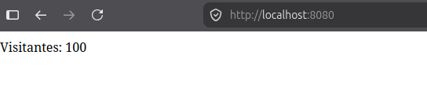

# DÍA DIEZ — PLANTILLAS, `Model` Y CONTADOR DE VISITAS

## Índice

1. [Resumen de la sesión](#resumen-de-la-sesión)
2. [De `@RestController` a `@Controller`](#de-restcontroller-a-controller)
3. [Práctica 1: contador de visitas](#práctica-1-contador-de-visitas)
4. [Concurrencia: threads, event loop y `AtomicInteger`](#concurrencia-threads-event-loop-y-atomicinteger)
5. [Práctica 2: `HolaMundoConPlantilla`](#práctica-2-holamundoconplantilla)
6. [Thymeleaf: la plantilla](#thymeleaf-la-plantilla)
7. [El recorrido completo de una petición](#el-recorrido-completo-de-una-petición)
8. [Errores y detalles detectados](#errores-y-detalles-detectados)
9. [Comparación con las bitácoras anteriores](#comparación-con-las-bitácoras-anteriores)
10. [Chuleta de código](#chuleta-de-código)
11. [Pendientes y preguntas](#pendientes-y-preguntas)

---

## Resumen de la sesión

El día 10 es el salto desde «devolver texto» hasta «devolver una página web». Hasta ahora un controlador respondía con un `String` que el navegador pintaba tal cual. Hoy aparecen las **plantillas** y, con ellas, una pregunta nueva: *¿cómo meto datos de Java dentro de un HTML?*

Lo que vimos:

- Un **contador de visitas** con `@RestController`: primero con un `int` normal y después con `AtomicInteger`.
- Por qué un campo de un controlador **se comparte entre peticiones** y entre hilos.
- Qué es una **condición de carrera** y qué significa que algo sea **thread-safe**.
- La diferencia entre **threads** (Tomcat / Spring MVC) y **event loop** (Node.js / WebFlux).
- El cambio de `@RestController` a **`@Controller`**: ya no se devuelve el texto, se devuelve el **nombre de una vista**.
- El objeto **`Model`** como puente entre el controlador y la plantilla.
- **Thymeleaf** y sus atributos `th:text`, `th:if`, `th:unless`, `th:each`…
- El proyecto **`HolaMundoConPlantilla`**, que recibe un nombre por la URL y lo saluda en una página HTML.

> 💡 **Idea clave del día:** con `@RestController` el controlador **escribe la respuesta**; con `@Controller` el controlador **elige una plantilla** y le pasa datos mediante `Model`. El HTML final lo construye Thymeleaf.

---

## De `@RestController` a `@Controller`

Ambas anotaciones marcan una clase como controlador web, pero no hacen lo mismo con el valor devuelto.

| Anotación | Qué hace con el `String` que devuelve el método | Resultado en el navegador |
| --- | --- | --- |
| `@RestController` | Lo escribe **tal cual** en el cuerpo de la respuesta (`@ResponseBody`) | Texto plano: `Visitantes: 3` |
| `@Controller` | Lo interpreta como **nombre de una vista** | El HTML renderizado por la plantilla |

En realidad `@RestController` es una abreviatura de dos anotaciones:

```java
@Controller
@ResponseBody
public @interface RestController { }
```

Por eso, si en un `@RestController` devuelves `"hola"`, el navegador **no** busca `hola.html`: te enseña literalmente la palabra `hola`.

```text
@RestController  →  return "hola"   →  cuerpo HTTP: hola
@Controller      →  return "hola"   →  templates/hola.html  →  HTML
```

> ⚠️ **Error típico:** mezclar las dos. Si tienes una plantilla y ves el nombre de la plantilla escrito en pantalla, casi seguro te sobra un `@RestController`.

---

## Práctica 1: contador de visitas

- **Proyecto:** `PROYECTOS/contadorVisita`
- **Ruta:** `/`
- **Stack:** Java 21 · Spring Boot 4.1.1 · Gradle · Spring Web MVC

### Primera versión: un `int` normal

La primera idea fue la más sencilla: guardar el contador en un campo de la clase y sumar uno en cada petición.

```java
package ruvik.contadorvisita;

import org.springframework.web.bind.annotation.GetMapping;
import org.springframework.web.bind.annotation.RestController;

@RestController
public class ControllerContadorVisitas {
    private int cotador;

    @GetMapping("/")
    public String contadorVisitas() {
        cotador++;

        return "Visitantes: " + cotador;
    }
}
```

Cada vez que se abre `http://localhost:8080/`, el número sube:



Funciona… mientras haya **una sola petición a la vez**. El problema aparece cuando dos personas (o dos pestañas) entran al mismo tiempo.

### El problema: el controlador es un singleton

Spring crea **una única instancia** de cada controlador y la reutiliza para todas las peticiones. Eso significa que el campo `cotador` **no es de cada usuario**: es compartido por todo el mundo.

```text
                    ┌─────────────────────────────┐
   Petición A ─────►│                             │
                    │   ControllerContadorVisitas │
   Petición B ─────►│   int cotador = 5           │  ← el mismo objeto
                    │                             │
   Petición C ─────►│                             │
                    └─────────────────────────────┘
```

Consecuencias:

- El contador **no es por visitante**: es global.
- Se **pierde al reiniciar** el servidor (vive en memoria).
- Y, sobre todo, `cotador++` **no es una operación atómica**.

### `cotador++` no es una sola operación

Aunque se escriba en una línea, por dentro son tres pasos:

```text
1. Leer el valor actual
2. Sumarle 1
3. Escribir el resultado
```

Si dos hilos se intercalan entre esos pasos, una visita se pierde:

```text
Hilo A            Hilo B            cotador
  │                 │                  5
  ├─ lee 5 ─────────┤                  5
  │                 ├─ lee 5 ────────── 5
  ├─ escribe 6 ─────┤                  6
  │                 ├─ escribe 6 ────── 6   ← debía ser 7
```

Esto es una **condición de carrera** (*race condition*): el resultado depende de quién llegue antes, y el contador se queda corto.

### Segunda versión: `AtomicInteger`

```java
package ruvik.contadorvisita;

import org.springframework.web.bind.annotation.GetMapping;
import org.springframework.web.bind.annotation.RestController;

import java.util.concurrent.atomic.AtomicInteger;

@RestController
public class ControllerContadorVisitas {
    private AtomicInteger cotador = new AtomicInteger(0);

    @GetMapping("/")
    public String contadorVisitas() {
        return "Visitantes: " + cotador.getAndAdd(1);
    }
}
```

`AtomicInteger` encapsula el número y hace que la suma sea **indivisible**: ningún otro hilo puede colarse en medio. Ya no hay visitas perdidas.

> 🧠 **Atomic** significa «indivisible»: la operación se hace **entera o no se hace**. Es la base de la concurrencia segura en Java.

---

## Concurrencia: threads, event loop y `AtomicInteger`

### Threads y procesos, en dos líneas

Un **proceso** tiene su propia memoria. Dentro de un proceso viven varios **threads** (hilos), que **comparten** esa memoria. Compartir es cómodo, pero también es la puerta de entrada a los conflictos. Lo vimos con más detalle en el [día 6](bitacpra-dia-seis.md).

```text
┌──────────────── PROCESO ────────────────┐
│  Thread 1    Thread 2    Thread 3       │
│      │           │           │          │
│      └───────────┼───────────┘          │
│                  ▼                      │
│          MEMORIA COMPARTIDA             │
└─────────────────────────────────────────┘
```

### Dos formas de atender peticiones

| Modelo | Cómo funciona | Ejemplo | Ventaja | Riesgo |
| --- | --- | --- | --- | --- |
| **Thread-per-request** | Cada petición ocupa un hilo hasta terminar | Tomcat / Spring MVC | Sencillo y directo | Muchos hilos = memoria y cambios de contexto |
| **Event loop** | Un bucle atiende muchas conexiones y va saltando entre ellas | Node.js / Netty / WebFlux | Escala con pocos hilos | Si una tarea bloquea, se bloquea todo |

Spring MVC (el que usamos) trabaja con **thread-per-request**. Por eso dos peticiones pueden tocar el mismo campo del controlador **a la vez**, y por eso `cotador++` era peligroso.

> ⚠️ **Matiz sobre mis apuntes originales:** escribí «Threads vs event loop» y «thread safe». La idea era correcta, pero conviene separar dos cosas: el **modelo de concurrencia** (threads o event loop) y la **seguridad** del código frente a varios hilos (*thread-safe*). Son conceptos distintos.

### Formas de proteger un contador

| Mecanismo | ¿Thread-safe? | Cuándo usarlo |
| --- | --- | --- |
| `int contador` + `contador++` | ❌ No | Nunca con concurrencia |
| `synchronized` | ✅ Sí | Varias operaciones que deben ir juntas |
| `AtomicInteger` | ✅ Sí | Contadores y operaciones simples |
| `LongAdder` | ✅ Sí | Muchísima contención y solo sumas |

`AtomicInteger` no usa un candado clásico: usa **CAS** (*compare-and-swap*), que consiste en «si el valor sigue siendo el que leí, cámbialo; si no, reintenta».

```text
1. Leo 5
2. Quiero escribir 6
3. ¿Sigue valiendo 5?  ── sí ──►  escribo 6
                       └─ no ──►  otro hilo lo cambió: vuelvo a intentarlo
```

### `getAndAdd` no es `incrementAndGet`

| Método | Qué devuelve | Primera visita | Segunda |
| --- | --- | --- | --- |
| `getAndAdd(1)` | El valor **anterior** | `0` | `1` |
| `incrementAndGet()` | El valor **nuevo** | `1` | `2` |

Por eso la versión con `getAndAdd(1)` empieza enseñando `Visitantes: 0`. Si queremos que la primera visita sea la 1, lo correcto es:

```java
return "Visitantes: " + contador.incrementAndGet();
```

> 🔗 **Conexión con el día 14:** aquí el contador es **global**. Cuando aprendimos `HttpSession`, vimos cómo guardar estado **por usuario** en el servidor. Un contador por visitante sería un dato de sesión, no un campo del controlador.

---

## Práctica 2: `HolaMundoConPlantilla`

- **Proyecto:** `PROYECTOS/HolaMundoConPlantilla`
- **Ruta:** `/saludo?nombre=...`
- **Stack:** Java 21 · Spring Boot 4.1.1 · Gradle · Spring Web MVC · Thymeleaf

### Dependencias

Para usar plantillas hay que añadir el starter de Thymeleaf:

```groovy
plugins {
    id 'java'
    id 'org.springframework.boot' version '4.1.1'
    id 'io.spring.dependency-management' version '1.1.7'
}

group = 'Ruvik'
version = '0.0.1-SNAPSHOT'
description = 'HolaMundoConPlantilla'

java {
    toolchain {
        languageVersion = JavaLanguageVersion.of(21)
    }
}

repositories {
    mavenCentral()
}

dependencies {
    implementation 'org.springframework.boot:spring-boot-starter-thymeleaf'
    implementation 'org.springframework.boot:spring-boot-starter-webmvc'
    developmentOnly 'org.springframework.boot:spring-boot-devtools'
    testImplementation 'org.springframework.boot:spring-boot-starter-thymeleaf-test'
    testImplementation 'org.springframework.boot:spring-boot-starter-webmvc-test'
    testRuntimeOnly 'org.junit.platform:junit-platform-launcher'
}

tasks.named('test') {
    useJUnitPlatform()
}
```

- **`spring-boot-starter-thymeleaf`** trae el motor de plantillas y lo conecta con Spring MVC.
- **`spring-boot-starter-webmvc`** trae Spring MVC y Tomcat embebido.
- **`spring-boot-devtools`** recarga la aplicación al guardar cambios.
- No hay que configurar rutas: Spring Boot asume `src/main/resources/templates/` y extensión `.html`.

### Estructura del proyecto

```text
HolaMundoConPlantilla/
├── build.gradle
├── settings.gradle
└── src/main/
    ├── java/ruvik/holamundoconplantilla/
    │   ├── HolaMundoConPlantillaApplication.java
    │   └── ControllerPlantilla.java
    └── resources/
        ├── application.properties
        └── templates/
            └── hola.html
```

| Carpeta | Qué contiene | ¿Se sirve directamente? |
| --- | --- | --- |
| `src/main/resources/static/` | CSS, JS, imágenes, HTML estático | ✅ Sí (`/fichero.css`) |
| `src/main/resources/templates/` | Plantillas que renderiza el controlador | ❌ No (`/hola.html` no existe) |

> 💡 Una plantilla **no es una página estática**: es un molde. El HTML final se genera en cada petición con los datos que le pasa el controlador.

### El controlador

```java
package ruvik.holamundoconplantilla;

import org.springframework.stereotype.Controller;
import org.springframework.ui.Model;
import org.springframework.web.bind.annotation.GetMapping;
import org.springframework.web.bind.annotation.RequestParam;

@Controller
public class ControllerPlantilla {

    @GetMapping("/saludo")
    public String index(
            @RequestParam(name = "nombre", defaultValue = "mundo cruel") String nombre,
            Model modelo) {

        modelo.addAttribute("mensaje", nombre);
        return "hola";
    }
}
```

Paso a paso:

1. **`@Controller`** marca la clase como controlador de vistas (no de respuestas directas).
2. **`@GetMapping("/saludo")`** asocia `GET /saludo` con el método `index`.
3. **`@RequestParam`** recoge el parámetro `nombre` de la URL. Si no viene, usa `"mundo cruel"`.
4. **`Model`** es la maleta donde se meten los datos para la plantilla.
5. **`addAttribute("mensaje", nombre)`** guarda el valor bajo la clave `mensaje`.
6. **`return "hola"`** es el **nombre lógico** de la vista → `templates/hola.html`.

### `@RequestParam` en detalle

| Parte | Significado |
| --- | --- |
| `name = "nombre"` | Nombre del parámetro en la URL (`?nombre=Ruvik`) |
| `defaultValue = "mundo cruel"` | Valor si el parámetro no aparece |
| `String nombre` | Variable Java donde se guarda |

```text
GET /saludo                 →  nombre = "mundo cruel"
GET /saludo?nombre=Ruvik    →  nombre = "Ruvik"
```

Si el parámetro fuera obligatorio, se quitaría `defaultValue` y Spring devolvería un error `400 Bad Request` cuando faltase.

### El `Model`

`Model` es una interfaz que Spring inyecta automáticamente. Funciona como un `Map<String, Object>`:

```java
modelo.addAttribute("mensaje", nombre);   // clave → valor
```

```text
Controlador                         Plantilla
─────────────                       ─────────
addAttribute("mensaje", "Ruvik") ──► ${mensaje} = "Ruvik"
```

| Método | Para qué sirve |
| --- | --- |
| `addAttribute("clave", valor)` | Añade un dato |
| `addAttribute(valor)` | Lo añade usando el nombre de la clase |
| `containsAttribute("clave")` | Comprueba si existe |
| `asMap()` | Devuelve el modelo como `Map` |

> ⚠️ **No confundir** el `Model` de Spring con la `M` de MVC. El `Model` de MVC es el **conjunto de datos** de la aplicación (por ejemplo, un `Producto`). El `Model` de Spring es solo el **transporte** entre controlador y vista.

---

## Thymeleaf: la plantilla

Thymeleaf es un motor de plantillas: escribe HTML normal y añade atributos `th:*` que Spring rellena antes de enviar la página.

### La plantilla del proyecto

```html
<!DOCTYPE html>
<html lang="es" xmlns:th="http://www.thymeleaf.org">
<head>
    <meta charset="UTF-8">
    <title>Ultramarines</title>
</head>
<body>

<h1 th:text="|Hola ${mensaje}|"></h1>

</body>
</html>
```

- **`xmlns:th="http://www.thymeleaf.org"`** habilita los atributos `th:*` (y evita avisos del editor).
- **`${mensaje}`** lee el valor que el controlador metió en el `Model`.
- **`|Hola ${mensaje}|`** es una **sustitución literal**: mezcla texto fijo y variables sin concatenar con `+`.
- **`th:text`** escribe el resultado **escapando** el HTML (protege frente a inyección).

### Sintaxis básica

| Atributo | Qué hace | Ejemplo |
| --- | --- | --- |
| `th:text` | Escribe texto escapado | `th:text="${mensaje}"` |
| `th:utext` | Escribe HTML sin escapar ⚠️ | `th:utext="${html}"` |
| `th:if` | Muestra el elemento si se cumple | `th:if="${edad >= 18}"` |
| `th:unless` | Muestra el elemento si **no** se cumple | `th:unless="${vacio}"` |
| `th:each` | Repite el elemento | `th:each="p : ${productos}"` |
| `th:href` | Genera una URL | `th:href="@{/saludo}"` |
| `th:action` | URL de un formulario | `th:action="@{/enviar}"` |
| `th:object` | Objeto de un formulario | `th:object="${usuario}"` |
| `th:field` | Campo enlazado al objeto | `th:field="*{nombre}"` |

### Expresiones

| Expresión | Tipo | Ejemplo |
| --- | --- | --- |
| `${...}` | Variable | `${mensaje}` |
| `@{...}` | URL | `@{/saludo(nombre='Ruvik')}` |
| `*{...}` | Campo de un objeto | `*{nombre}` |
| `|...|` | Texto con variables | `|Hola ${mensaje}|` |

### Ejemplos útiles

```html
<!-- Condicional -->
<p th:if="${mensaje != null}" th:text="${mensaje}">Texto por defecto</p>
<p th:unless="${mensaje != null}">No hay mensaje</p>

<!-- Recorrer una lista -->
<ul>
    <li th:each="producto : ${productos}" th:text="${producto.nombre}">Producto</li>
</ul>

<!-- Enlace con parámetro -->
<a th:href="@{/saludo(nombre='Ruvik')}">Saludar a Ruvik</a>
```

> ⚠️ **Corrección a mis apuntes originales:** escribí `th:eless` y `th:else`. En Thymeleaf **no existe `th:else`** ni `th:eless`. El contrario de `th:if` es **`th:unless`**. Para varios casos se usa `th:switch` / `th:case`.

---

## El recorrido completo de una petición

Así viaja una petición desde el navegador hasta el HTML final:

```text
Navegador
   │  GET /saludo?nombre=Ruvik
   ▼
Tomcat (servidor embebido)
   │
   ▼
DispatcherServlet  ──►  busca el método con @GetMapping("/saludo")
   │
   ▼
ControllerPlantilla.index()
   │  nombre = "Ruvik"
   │  modelo.addAttribute("mensaje", "Ruvik")
   │  return "hola"
   ▼
ThymeleafViewResolver
   │  prefijo: classpath:/templates/
   │  sufijo:  .html
   ▼
templates/hola.html  ──►  ${mensaje} = "Ruvik"
   │
   ▼
HTML final  ──►  Navegador
```

| Pieza | Responsabilidad |
| --- | --- |
| **Tomcat** | Recibe la conexión HTTP |
| **DispatcherServlet** | Decide qué controlador atiende la ruta |
| **Controlador** | Ejecuta la lógica y llena el `Model` |
| **ViewResolver** | Traduce `"hola"` a `templates/hola.html` |
| **Thymeleaf** | Sustituye las expresiones y genera el HTML |

> 💡 El controlador **no escribe HTML**: solo elige la vista y le pasa datos. Esa separación es exactamente la **V** y la **C** de MVC (vista y controlador), que vimos en el [día 9](bitacora-dia-nueve.md).

---

## Errores y detalles detectados

Revisando el código y los apuntes originales he encontrado varios puntos que conviene dejar anotados.

### 1. `getAndAdd(1)` devuelve el valor anterior ⚠️

```java
return "Visitantes: " + cotador.getAndAdd(1);   // primera visita: 0
```

La primera visita muestra `0`. Si se quiere empezar en `1`:

```java
return "Visitantes: " + contador.incrementAndGet();
```

### 2. Typo `cotador` → `contador`

El campo se llama `cotador` en el proyecto. Funciona, pero conviene corregirlo para que el código se lea sin ruido.

### 3. Imports que sobran

En `ControllerPlantilla` sobra `import org.springframework.web.bind.annotation.RestController;`. No rompe nada, pero ensucia la clase.

### 4. `return "hola.html"` frente a `return "hola"`

En los apuntes originales devolvía `"hola.html"`. Lo idiomático es devolver el **nombre lógico** sin extensión (`"hola"`), porque el `ViewResolver` ya añade `templates/` y `.html`. Es la convención que sigue el proyecto final.

### 5. `@RestController` con plantilla = texto literal

Si cambias `@Controller` por `@RestController` y devuelves `"hola"`, el navegador muestra la palabra `hola` en vez de la página. No es un fallo de Thymeleaf: es que `@ResponseBody` escribe el `String` directamente.

### 6. El contador es global, no por visitante

Todas las personas comparten el mismo número, y se reinicia al reiniciar la aplicación. Para un contador real haría falta persistencia (base de datos) o, si es por usuario, una **sesión** ([día 13](bitacora-dia-trece.md)).

### 7. `int` no es thread-safe

La primera versión podía perder visitas con peticiones simultáneas. `AtomicInteger` lo resuelve, pero la lección general es: **no guardes estado mutable en campos de un controlador singleton** sin protegerlo.

### 8. `th:else` no existe

Como se explicó arriba, el contrario de `th:if` es `th:unless`. Si necesitas varios casos, usa `th:switch` y `th:case`.

### 9. La plantilla no se sirve directamente

Abrir `http://localhost:8080/hola.html` **no** funciona: las plantillas de `templates/` solo se renderizan a través de un controlador. Los ficheros que se sirven tal cual van en `static/`.

---

## Comparación con las bitácoras anteriores

### Línea temporal

| Día | Qué se aprendió | Proyecto |
| --- | --- | --- |
| **1** | Servidores de desarrollo web | — |
| **2** | El protocolo HTTP | — |
| **3** | Anatomía de una URL | — |
| **4** | Presentaciones de compañeros | — |
| **5** | Conceptos de las presentaciones (CLI y más) | — |
| **6** | Backend Java: sockets, servlets, hilos, MVC, Spring Boot | — |
| **7** | Primer endpoint `GET`, formulario `POST`, `@RequestParam` | `demo` |
| **8** | Familiarización con Spring Boot | `demo` |
| **9** | MVC (Modelo / Vista / Controlador) y estructura Spring Boot | — |
| **10** | `@Controller`, plantillas Thymeleaf, `Model`, hilos y `AtomicInteger` | `contadorVisita`, `HolaMundoConPlantilla` |
| **11** | Lombok (`@Data`), `@ModelAttribute` y el nombre del objeto | `demoFormulario` |
| **12** | `redirect` no envía datos, `@ModelAttribute` vs `@RequestParam` | `PracticandoFormulario` |
| **13** | *(bitácora vacía — pendiente)* | — |
| **14** | HTTP sin estado, cookies, sesiones, `HttpSession`, carrito | `Carrito-compra-gemini` |

### Qué aporta cada día a lo de hoy

```text
Día 6   hilos y memoria compartida ──►  por qué `cotador++` falla
   │
Día 7   GET/POST + @RequestParam   ──►  /saludo?nombre=...
   │
Día 9   MVC: M / V / C             ──►  controlador + plantilla + datos
   │
Día 10  @Controller + Model        ──►  Thymeleaf y AtomicInteger
   │
Día 11  @ModelAttribute            ──►  pasar un objeto entero a la vista
   │
Día 12  redirect                   ──►  volver a una vista tras un POST
   │
Día 13  HttpSession                ──►  estado por usuario, no global
```

### Antes y después del día 10

| Aspecto | Día 7 (`@RestController`) | Día 10 (`@Controller`) |
| --- | --- | --- |
| Qué devuelve el método | Texto de la respuesta | Nombre de la vista |
| Dónde está el HTML | `static/index.html` | `templates/hola.html` |
| Cómo llegan los datos | Concatenando `String` | `Model.addAttribute(...)` |
| Quién genera el HTML | El propio controlador | Thymeleaf |
| Estado del contador | No existía | Campo compartido + `AtomicInteger` |
| Preocupación nueva | Rutas y verbos HTTP | Concurrencia y seguridad de hilos |

### Lo que se mantiene

- **`@GetMapping` / `@PostMapping`** siguen funcionando igual.
- **`@RequestParam`** sigue recogiendo parámetros de la URL.
- **MVC** no cambia: solo se hace visible la separación entre controlador y vista.
- **Spring Boot + Gradle** siguen arrancando la aplicación con `./gradlew bootRun`.
- **Tomcat embebido** sigue siendo el servidor.

### Lo que cambia de verdad

1. **La respuesta deja de ser un `String`**: ahora es una vista renderizada.
2. **Aparece el `Model`** como transporte de datos entre Java y HTML.
3. **El HTML deja de ser estático**: se genera en cada petición.
4. **La concurrencia entra en escena**: un controlador singleton puede recibir varias peticiones a la vez.
5. **`AtomicInteger` introduce la programación thread-safe**, que será clave en sesiones y carritos.

> 🧠 **Conclusión:** los días anteriores enseñaban a **responder**; el día 10 enseña a **componer una página** con datos y a **compartir estado sin romperlo**. Es el puente entre «hola mundo» y una aplicación web de verdad.

---

## Chuleta de código

```java
// @RestController: devuelve el texto tal cual
@RestController
public class ControllerContadorVisitas {
    private final AtomicInteger contador = new AtomicInteger(0);

    @GetMapping("/")
    public String contadorVisitas() {
        return "Visitantes: " + contador.incrementAndGet();
    }
}
```

```java
// @Controller: devuelve el nombre de una vista
@Controller
public class ControllerPlantilla {

    @GetMapping("/saludo")
    public String index(
            @RequestParam(name = "nombre", defaultValue = "mundo cruel") String nombre,
            Model modelo) {

        modelo.addAttribute("mensaje", nombre);
        return "hola";          // → templates/hola.html
    }
}
```

```java
// Contador thread-safe
private final AtomicInteger contador = new AtomicInteger(0);
contador.incrementAndGet();     // devuelve el valor nuevo
contador.getAndAdd(1);          // devuelve el valor anterior
contador.get();                 // solo leer
```

```html
<!-- Plantilla Thymeleaf -->
<h1 th:text="|Hola ${mensaje}|"></h1>

<p th:if="${mensaje != null}" th:text="${mensaje}"></p>
<p th:unless="${mensaje != null}">No hay mensaje</p>

<ul>
    <li th:each="p : ${productos}" th:text="${p.nombre}">Producto</li>
</ul>

<a th:href="@{/saludo(nombre='Ruvik')}">Saludar</a>
```

```groovy
// Dependencias necesarias para plantillas
implementation 'org.springframework.boot:spring-boot-starter-thymeleaf'
implementation 'org.springframework.boot:spring-boot-starter-webmvc'
```

```text
templates/  →  solo se renderiza desde un controlador
static/     →  se sirve tal cual (/css, /js, /imagenes)
```

---

## Pendientes y preguntas

- [ ] Corregir el typo `cotador` → `contador` en el proyecto.
- [ ] Cambiar `getAndAdd(1)` por `incrementAndGet()` y comprobar que la primera visita es `1`.
- [ ] Eliminar el import de `RestController` que sobra en `ControllerPlantilla`.
- [ ] Probar a devolver `"hola.html"` y comparar con `"hola"`.
- [ ] Añadir a `hola.html` un `th:if`, un `th:unless` y un `th:each` de prueba.
- [ ] Comprobar que `http://localhost:8080/hola.html` **no** funciona y explicar por qué.
- [ ] Abrir el contador en dos navegadores y ver que **comparten** el mismo número.
- [ ] Reiniciar el servidor y comprobar que el contador vuelve a `0`.
- [ ] Convertir el contador global en un contador **por sesión** (día 14).
- [ ] Rellenar la **bitácora del día 13**, que está vacía.
- [ ] ¿Qué pasa si dos hilos llaman a `incrementAndGet()` exactamente a la vez? ¿Por qué no se pierde ninguna visita?

---

**Relacionado:** [[bitacora-dia-nueve]] · [[bitacora-dia-once]] · [[bitacora-dia-doce]] · [[bitacora-dia-trece]] · [[bitacpra-dia-seis]] · [[bitacora-dia-siete]]

**Proyectos:** `PROYECTOS/contadorVisita` · `PROYECTOS/HolaMundoConPlantilla`

**TODO LO VISTO CONVERGE AHÍ:** [[D1 -UD2]]
